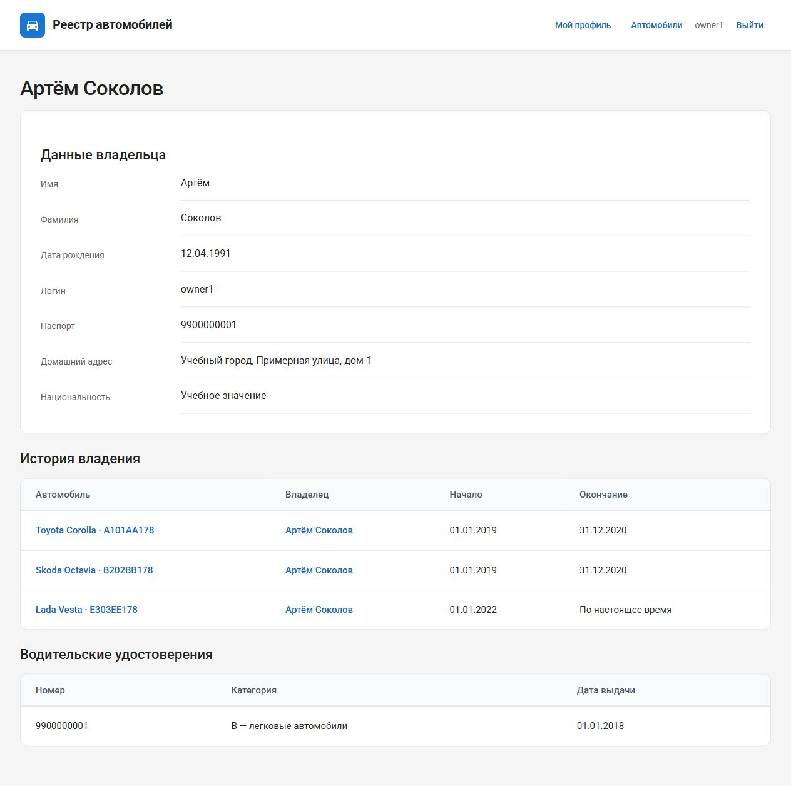

# Практика 2.1. Модели, Admin и карточка владельца

**Трикула Артём, K3341.** [Условие](https://rendex85.github.io/ITMO_ICT_WebDevelopment_Docs/lab2/practice1/).

Практики объединены в `Lr2/practical_works`. Здесь описана первая часть общего приложения; [запуск и проверка](report.md) едины для всех трёх заданий.

## Выполненные задания

- Проект `django_project_trikula`, приложение `project_first_app`, общее окружение Poetry.
- Модели `CarOwner`, `Car`, `Ownership`, `DriverLicense`; имена таблиц и полей на латинице.
- M2M автомобилей и владельцев через владение с датами; FK удостоверения к владельцу; категории через `TextChoices`.
- Начальная миграция PostgreSQL, `btree_gist`, проверка порядка дат и исключение пересекающихся периодов одного автомобиля.
- Все четыре модели в Admin, суперпользователь `admin`, поиск, фильтры и inline-формы.
- FBV `owner_detail` с шаблоном `owner.html`; маршрут `/owner/<id>/` подключён через URLconf приложения и `include()`.

В демонстрационной базе шесть владельцев и администратор, семь автомобилей. У первых двух владельцев есть по три автомобиля в истории: Toyota и Skoda переходят к следующему владельцу на следующий день после окончания предыдущего периода, Lada и Kia остаются у своих владельцев. Начальные и конечные дни включены в период.

В итоговом проекте `CarOwner` уже является пользователем согласно практике 2.3. Календарные даты реализованы как `DateField`, обязательные участники владения не допускают `NULL`; госномер и номер удостоверения уникальны. Доступ к карточке владельца открыт ему самому и сотруднику, поскольку она содержит личные данные.

## Модель данных

| Модель | Основные данные | Связи |
|---|---|---|
| `CarOwner` | ФИО, дата рождения, учётная запись и дополнительные сведения | M2M с автомобилями |
| `Car` | Госномер, марка, модель, цвет | M2M через `Ownership` |
| `Ownership` | Даты начала/окончания | FK к владельцу и автомобилю |
| `DriverLicense` | Номер, категория и дата выдачи | FK к владельцу |

## Проверка

Общие тесты проверяют карточку по ID и 404, экранирование текста, страницы Admin, создание владения через Admin, ограничения PostgreSQL и пересечения нескольких новых inline-записей. Миграции применены, `makemigrations --check --dry-run` не обнаруживает изменений.



## models.py

```python
--8<-- "Lr2/practical_works/project_first_app/models.py"
```

## admin.py

```python
--8<-- "Lr2/practical_works/project_first_app/admin.py"
```

## urls.py

```python
--8<-- "Lr2/practical_works/project_first_app/urls.py"
```

## Шаблон owner.html

```html
--8<-- "Lr2/practical_works/project_first_app/templates/owner.html"
```
