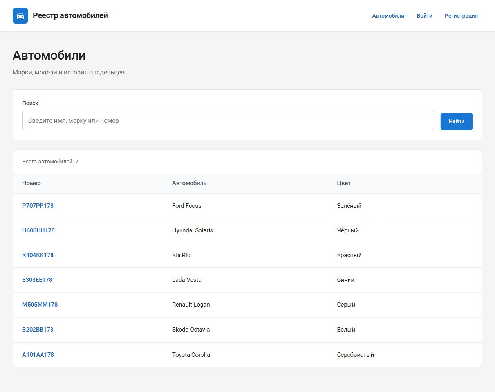

# Практика 2.2. Представления и формы

**Трикула Артём, K3341.** [Условие](https://rendex85.github.io/ITMO_ICT_WebDevelopment_Docs/lab2/practice2/).

Вторая практика развивает те же модели общего проекта `Lr2/practical_works`. [Запуск и результаты](report.md).

## Выполненные задания

- M2M объявлена с `through="Ownership"`: отношение имеет даты начала и окончания.
- Список владельцев `owner_list` и создание `owner_create` — FBV с HTML-шаблонами.
- Список и карточка автомобилей — `ListView` и `DetailView`.
- Создание, обновление и удаление автомобиля — `CreateView`, `UpdateView`, `DeleteView` с явной `CarForm`.
- В итоговой форме владельца используется `UserCreationForm` с дополнительными атрибутами из практики 2.3. Она сохраняет функциональный обработчик.
- Демонстрационные данные включают шесть владельцев и семь автомобилей. HTTP-тесты создают ещё по три владельца и автомобиля через соответствующие формы в изолированной тестовой базе.

## Маршруты

| URL | Реализация |
|---|---|
| `/owners/` | FBV списка владельцев, сотрудники |
| `/owners/create/` | FBV регистрации владельца, открыта |
| `/cars/`, `/cars/<id>/` | CBV списка и карточки |
| `/cars/create/` | CBV создания, сотрудники |
| `/cars/<id>/update/` | CBV обновления, сотрудники |
| `/cars/<id>/delete/` | CBV удаления, сотрудники; GET — подтверждение, POST — удаление |

Списки содержат поиск и пагинацию с сохранением запроса. После успешной отправки формы выполняется redirect. CSRF включён, права проверяются сервером, а формы содержат только разрешённые поля.

## Проверка

Общий набор тестов проверяет выбор FBV/CBV, создание и изменение автомобиля, подтверждение и удаление, три HTTP-отправки каждой формы, ошибки уникальности, CSRF и отказ обычному пользователю в изменениях.



## views.py

```python
--8<-- "Lr2/practical_works/project_first_app/views.py"
```

## forms.py

```python
--8<-- "Lr2/practical_works/project_first_app/forms.py"
```

## Шаблон project_first_app/form.html

```html
--8<-- "Lr2/practical_works/project_first_app/templates/project_first_app/form.html"
```

## Шаблон project_first_app/car_confirm_delete.html

```html
--8<-- "Lr2/practical_works/project_first_app/templates/project_first_app/car_confirm_delete.html"
```
