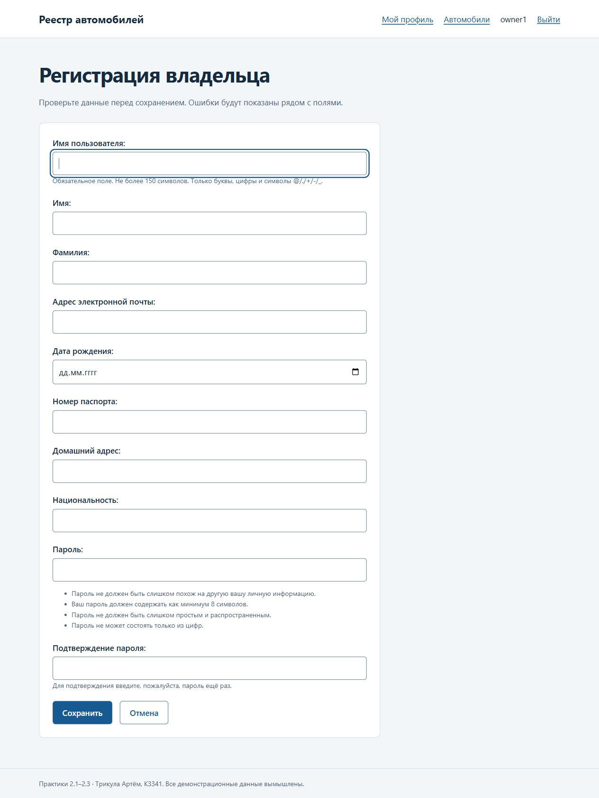
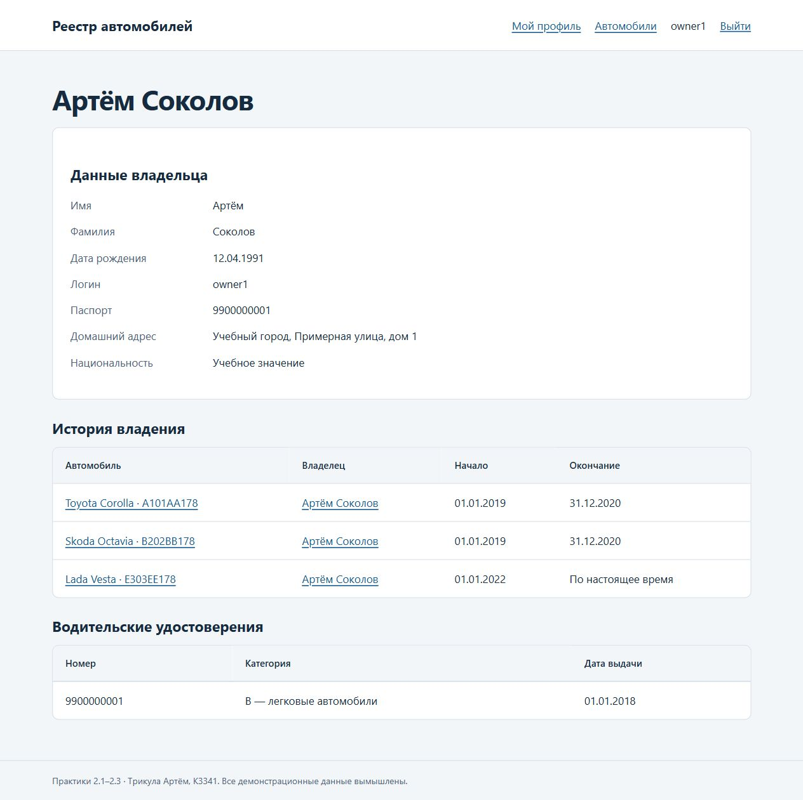

# Практика 2.3. Владелец-пользователь

**Трикула Артём, K3341.** [Условие](https://rendex85.github.io/ITMO_ICT_WebDevelopment_Docs/lab2/practice3/).

Расширенный пользователь применяется ко всем страницам единого проекта `Lr2/practical_works`. [Запуск и проверка](report.md).

## Выполненные задания

- `CarOwner(AbstractUser)` содержит номер паспорта, домашний адрес и национальность, сохраняет имя, фамилию и дату рождения.
- `AUTH_USER_MODEL` определён до первой миграции; пользователь создан в `0001_initial`.
- Внешние ключи владений и удостоверений используют `settings.AUTH_USER_MODEL`.
- `CarOwnerAdmin(UserAdmin)` отображает дополнительные поля в списке, формах создания и изменения.
- Открытая регистрация — `OwnerCreationForm(UserCreationForm)` и FBV `owner_create`; пароли хешируются штатно.
- Карточка владельца и все связанные представления используют общую пользовательскую модель.

## Доступ и проверка

Паспорт состоит из десяти цифр и уникален; адрес и национальность обязательны при регистрации. Поля привилегий не включены в пользовательскую форму. Карточка с личными данными доступна только самому владельцу и сотруднику; публичная карточка автомобиля не раскрывает паспорт и адрес.

Администратор — `admin`, обычные пользователи — `owner1`–`owner6`. Начальный демонстрационный пароль указан в `DJANGO_DEMO_PASSWORD` локального `.env`; существующие пароли при объединении сохранены. Данные вымышлены.

Общий набор из **20 тестов** включает регистрацию, хеширование пароля, запрет повышения привилегий, ошибки паспорта и пароля, доступ к своему/чужому профилю, дополнительные поля в Admin и проверки предыдущих практик. Число сократилось с 47 за счёт устранения повторяющихся проверок трёх копий приложения.





## admin.py

```python
--8<-- "Lr2/practical_works/project_first_app/admin.py"
```

## forms.py

```python
--8<-- "Lr2/practical_works/project_first_app/forms.py"
```

## Шаблон project_first_app/form_fields.html

```html
--8<-- "Lr2/practical_works/project_first_app/templates/project_first_app/form_fields.html"
```

## Шаблон registration/login.html

```html
--8<-- "Lr2/practical_works/project_first_app/templates/registration/login.html"
```
