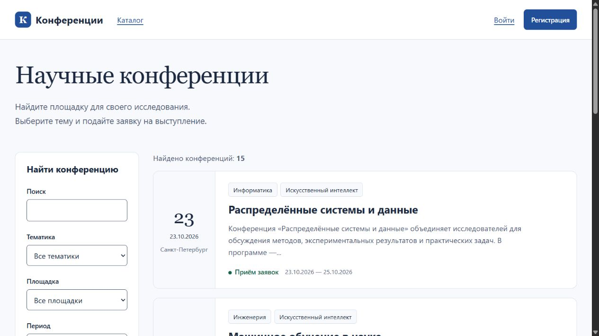
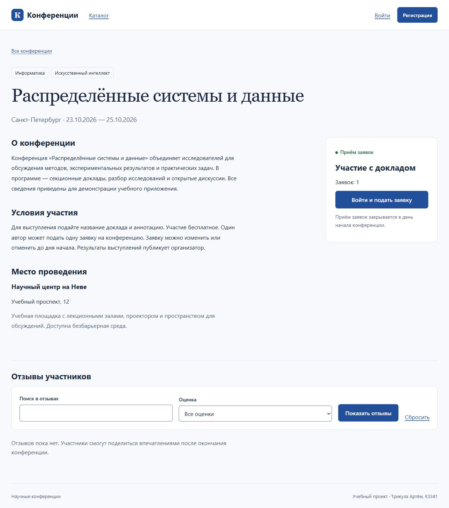
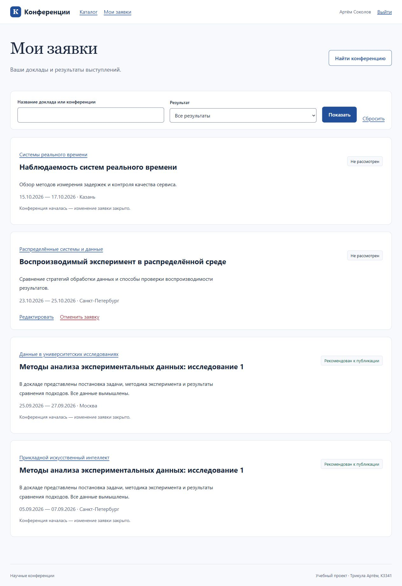
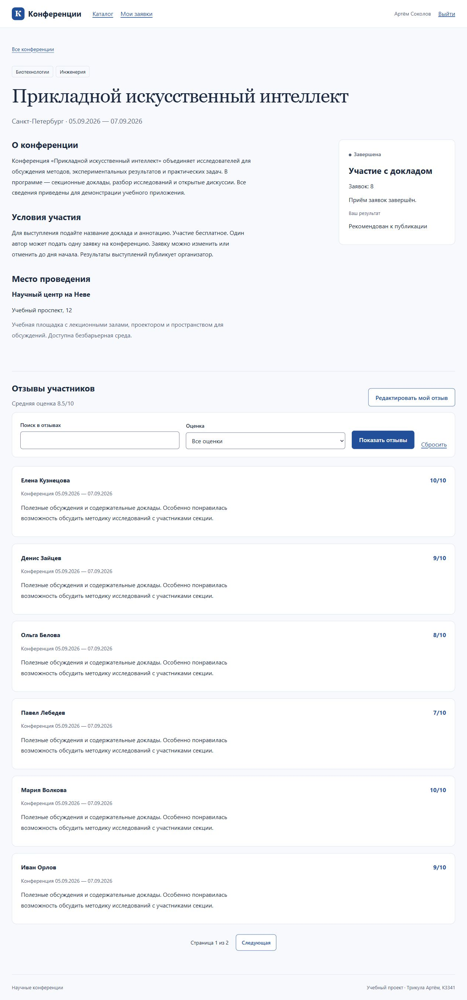
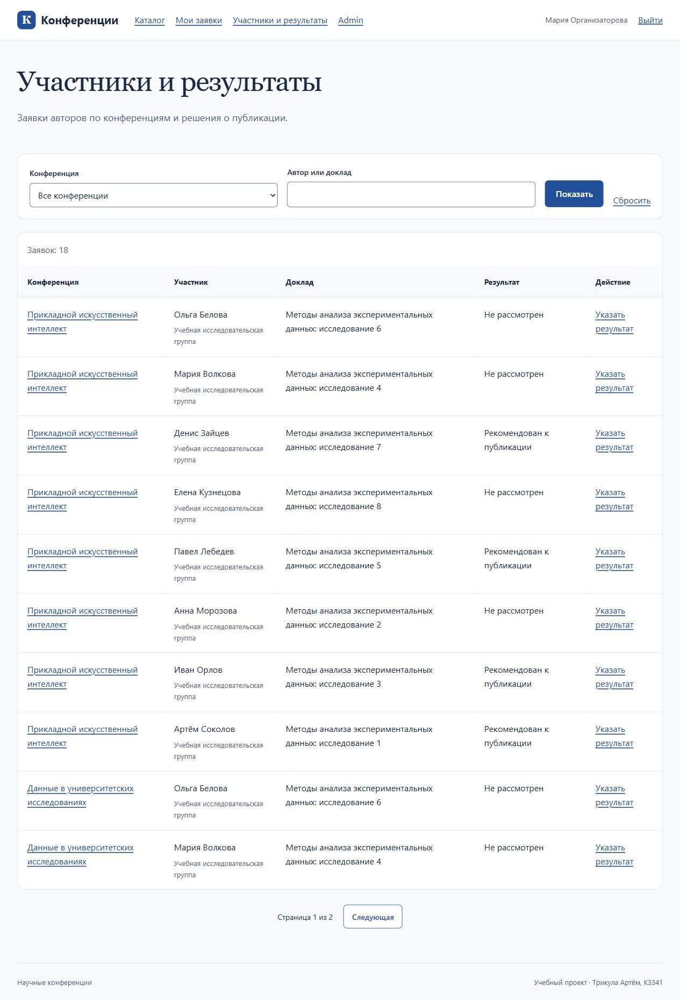
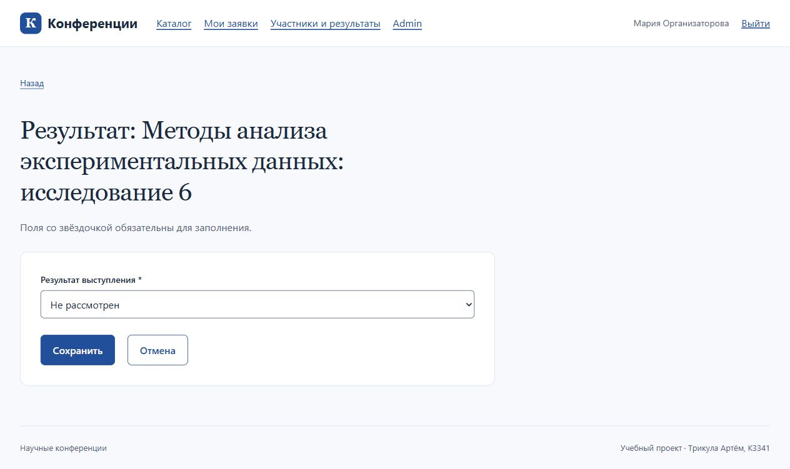

# Вариант 5. Научные конференции

**Трикула Артём, K3341.** [Условие ЛР2](https://rendex85.github.io/ITMO_ICT_WebDevelopment_Docs/lab2/assignment/).

Самостоятельный Django-проект на PostgreSQL с пользовательскими шаблонами Jinja2 и отдельной базой `lr2_conferences`. Практики находятся в соседнем проекте; окружение Poetry общее. Используются Django 6.1.2 и Python 3.13.

## Выполненные требования

| Требование | Реализация |
|---|---|
| Сведения о конференциях | Название, тематики, описание, даты, площадка с адресом и описанием, условия участия |
| Регистрация пользователей | Расширенный `AbstractUser`, штатные проверка и хеширование пароля, вход и выход |
| Заявки авторов | Название и аннотация доклада, создание, изменение и отмена своей заявки |
| Отзывы | Автор, текст, оценка 1–10, даты конференции; создание и изменение своего отзыва |
| Результат выступления | Решение о рекомендации к публикации в Admin и интерфейсе организатора |
| Таблица участников | Конференция, автор, организация, доклад, результат; сортировка по конференциям и фильтр |
| Дополнительные требования | Собственный CSS, адаптивная вёрстка, поиск, фильтры и пагинация, роли в интерфейсе сайта |

## Запуск

Из директории студента:

```powershell
poetry install
poetry run python Lr2/variant5/manage.py migrate
poetry run python Lr2/variant5/manage.py seed_demo
poetry run python Lr2/variant5/manage.py runserver 127.0.0.1:8005
```

[Каталог](http://127.0.0.1:8005/), [Admin](http://127.0.0.1:8005/admin/).

Настройки читаются из `Lr2/.env`: `POSTGRES_HOST`, `POSTGRES_PORT`, `POSTGRES_DB`, `POSTGRES_USER`, `POSTGRES_PASSWORD`, отдельный `CONFERENCES_SECRET_KEY`. На другом компьютере заполните настройки по `.env.example`, предварительно создав базу и роль PostgreSQL. Не заменяйте существующий `.env` примером.

Команда `seed_demo` создаёт 15 конференций, 18 заявок и 12 отзывов: будущие, текущую и завершённые конференции. Даты рассчитываются при первом заполнении. Данные вымышлены. Повторный запуск не сбрасывает пароли существующих пользователей.

| Пользователь | Назначение |
|---|---|
| `admin` | Суперпользователь Django |
| `organizer` | Организатор: конференции, участники, результаты |
| `researcher` | Автор: заявки и отзывы |
| `author2`–`author8` | Дополнительные демонстрационные авторы |

Начальный пароль указан в `DJANGO_DEMO_PASSWORD` локального `.env`.

## Архитектура и модель данных

`config` содержит настройки и маршруты, `accounts` — пользователя и регистрацию, `conferences` — предметную область. Формы явно перечисляют разрешённые поля. Представления отвечают за HTTP и выборку; `services.py` выполняет изменения в транзакциях, `rules.py` содержит общие правила сроков. У Django Admin остаётся стандартный движок шаблонов; страницы сайта используют Jinja2.

| Модель | Основные поля | Связи |
|---|---|---|
| `User` | Учётная запись, имя, фамилия, email, организация | Автор заявок и отзывов |
| `Topic` | Уникальное название тематики | M2M с конференциями |
| `Venue` | Название, город, адрес, описание | Одна площадка — много конференций |
| `Conference` | Название, описание, начало, окончание, условия | FK площадки, M2M тематик |
| `Registration` | Название доклада, аннотация, результат, время изменений | FK автора и конференции |
| `Review` | Текст, оценка, сохранённые даты конференции, время создания | FK автора и конференции |

Один автор имеет не более одной заявки и одного отзыва на конференцию. Заявку можно создать, изменить или отменить до дня начала; с наступлением этого дня изменения закрыты. Отзыв доступен зарегистрированному участнику после дня окончания. Даты конференции сохраняются в отзыве как исторический снимок и не меняются при его редактировании.

PostgreSQL дополнительно проверяет уникальность пар автор–конференция, порядок дат, диапазон оценки и допустимые значения результата. Изменения заявки и сроков конференции используют блокировку строки конференции внутри транзакции. Результат задаётся отдельным действием с разрешением `set_publication_result`.

## Маршруты и права

| URL | Доступ и действие |
|---|---|
| `/` | Публичный каталог, поиск, тематика, площадка, период; 6 объектов на страницу |
| `/conferences/<id>/` | Публичная карточка, средняя оценка, поиск и фильтр отзывов; 6 отзывов на страницу |
| `/accounts/signup/`, `/accounts/login/` | Регистрация и вход |
| `/accounts/logout/` | Выход через POST |
| `/my/registrations/` | Свои заявки, поиск и фильтр результата; 6 объектов на страницу |
| `/conferences/<id>/register/` | Подача заявки вошедшим автором |
| `/my/registrations/<id>/edit/`, `/delete/` | Изменение и подтверждение отмены своей заявки |
| `/conferences/<id>/review/` | Отзыв участника завершённой конференции |
| `/my/reviews/<id>/edit/` | Изменение своего отзыва |
| `/manage/participants/` | Таблица участников, поиск и фильтр конференции; 10 объектов на страницу |
| `/manage/registrations/<id>/result/` | Решение о публикации с отдельным разрешением |
| `/manage/conferences/create/`, `/manage/conferences/<id>/edit/` | Создание и изменение конференции с соответствующим разрешением |
| `/admin/` | Администрирование всех предметных моделей |

Группа «Организаторы» получает разрешения приложения конференций. Сам по себе `is_staff` не предоставляет права управлять результатами на сайте. Чужие заявки и отзывы не выдаются через маршруты редактирования. Права проверяются сервером, а не только скрытием кнопок. Изменения используют POST и CSRF, пользовательский текст экранируется.

## Проверка

```powershell
poetry run python Lr2/variant5/manage.py test conferences --settings=config.test_settings --keepdb --noinput
poetry run python Lr2/variant5/manage.py check
poetry run python Lr2/variant5/manage.py makemigrations --check --dry-run
poetry run ruff check Lr2/variant5
poetry run ruff format --check Lr2/variant5
```

**31 тест прошёл на PostgreSQL.** Проверены регистрация и вход, права и чужие объекты, полный цикл заявки, границы дат, отзывы и исторические даты, ограничения БД, поиск и пагинация, решения организатора и Admin, CSRF, экранирование и повторное заполнение демонстрационных данных. Проверки Django, согласованность миграций и Ruff пройдены.

База `test_lr2_conferences` заранее создана с владельцем `lr2_test`; используются `POSTGRES_TEST_USER` и `POSTGRES_TEST_PASSWORD`. Роль не имеет `CREATEDB`, поэтому нужен `--keepdb`. Ускоренный хешер включён только в тестовых настройках.

В браузере проверены каталог, карточка, вход автора и организатора, личные заявки, отзывы, таблица участников и форма результата.

## Интерфейс













Коммиты и публикация не выполнялись.
